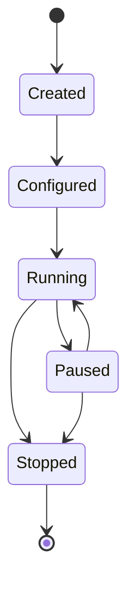

# CryptoTrader Bot Architecture

## Overview
This document outlines the architecture and workflow for managing trading bots in the CryptoTrader platform. The design focuses on flexibility, maintainability, and ease of use.

## Core Components

### 1. Bot Framework
```
/backend/bots/
├── base/
│   ├── bot_base.py          # Abstract base class for all bots
│   ├── strategy_base.py     # Abstract base class for strategies
│   └── signal_base.py       # Abstract base class for signals
├── strategies/
│   ├── mean_reversion.py
│   ├── trend_following.py
│   └── custom_strategy.py
├── signals/
│   ├── technical_signals.py
│   ├── sentiment_signals.py
│   └── custom_signals.py
└── instances/
    └── bot_instances.py     # Bot instance management
```

### 2. Bot Lifecycle States


## Bot Creation Workflow

1. **Bot Definition**
   ```python
   class MyTradingBot(BotBase):
       def __init__(self, config: BotConfig):
           super().__init__(config)
           self.strategy = self.load_strategy()
           self.signals = self.load_signals()

       async def execute(self):
           # Bot execution logic
           pass
   ```

2. **Strategy Implementation**
   ```python
   class MyStrategy(StrategyBase):
       def __init__(self, params: dict):
           self.params = params

       async def analyze(self, data: MarketData) -> TradeDecision:
           # Strategy analysis logic
           pass
   ```

3. **Signal Definition**
   ```python
   class MySignal(SignalBase):
       async def generate(self, data: MarketData) -> SignalResult:
           # Signal generation logic
           pass
   ```

## Configuration System

### Bot Configuration
```yaml
bot_config:
  name: "MyTradingBot"
  pair: "BTC/USDT"
  timeframe: "1h"
  strategy:
    name: "MeanReversion"
    params:
      window: 20
      std_dev: 2
  signals:
    - name: "RSI"
      params:
        period: 14
    - name: "MACD"
      params:
        fast: 12
        slow: 26
```

## API Endpoints

### Bot Management
```
POST    /api/bots/create              # Create new bot
GET     /api/bots                     # List all bots
GET     /api/bots/{bot_id}           # Get bot details
PUT     /api/bots/{bot_id}/config    # Update bot config
POST    /api/bots/{bot_id}/start     # Start bot
POST    /api/bots/{bot_id}/stop      # Stop bot
POST    /api/bots/{bot_id}/pause     # Pause bot
DELETE  /api/bots/{bot_id}           # Delete bot
```

### Strategy Management
```
GET     /api/strategies              # List available strategies
POST    /api/strategies/backtest     # Run strategy backtest
GET     /api/strategies/{id}/params  # Get strategy parameters
```

## Usage Example

```python
# Create a new bot instance
bot_config = {
    "name": "BTC_MeanReversion",
    "pair": "BTC/USDT",
    "strategy": {
        "name": "MeanReversion",
        "params": {"window": 20}
    }
}

async def main():
    # Initialize bot
    bot = await BotManager.create_bot(bot_config)
    
    # Start trading
    await bot.start()
    
    # Monitor performance
    while True:
        status = await bot.get_status()
        if status.requires_attention:
            await bot.handle_alerts()
        await asyncio.sleep(60)
```

## Best Practices

1. **Strategy Development**
   - Keep strategies isolated and independent
   - Use dependency injection for external services
   - Implement proper error handling and logging
   - Add comprehensive unit tests

2. **Signal Implementation**
   - Make signals composable and reusable
   - Implement signal validation
   - Add signal strength indicators
   - Document signal parameters

3. **Bot Management**
   - Use proper state management
   - Implement graceful shutdown
   - Add performance monitoring
   - Set up alerting system

4. **Testing**
   - Unit test individual components
   - Integration test bot workflows
   - Backtest strategies thoroughly
   - Use paper trading before live deployment

## Development Workflow

1. **Creating a New Bot**
   ```bash
   python manage.py create-bot --name MyBot --strategy MeanReversion --pair BTC/USDT
   ```

2. **Testing Strategy**
   ```bash
   python manage.py backtest --strategy MeanReversion --pair BTC/USDT --timeframe 1h --start 2023-01-01
   ```

3. **Deploying Bot**
   ```bash
   python manage.py deploy-bot --id my_bot_id --mode paper  # Start with paper trading
   python manage.py deploy-bot --id my_bot_id --mode live   # Move to live trading
   ```

## Monitoring and Maintenance

1. **Performance Metrics**
   - Win/Loss ratio
   - Profit/Loss
   - Maximum drawdown
   - Sharpe ratio
   - Trade frequency

2. **Health Checks**
   - API connectivity
   - Database status
   - Order execution latency
   - Memory usage
   - CPU utilization

3. **Alerts**
   - Unusual trading patterns
   - Large losses
   - Technical issues
   - API errors
   - Balance thresholds

## Security Considerations

1. **API Key Management**
   - Secure storage of API keys
   - Regular key rotation
   - Limited API permissions
   - IP whitelisting

2. **Risk Management**
   - Position size limits
   - Stop-loss mechanisms
   - Maximum drawdown limits
   - Order validation

3. **System Security**
   - Regular security audits
   - Dependency updates
   - Access control
   - Audit logging
