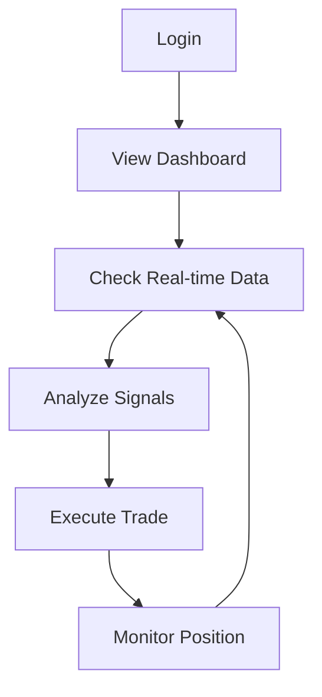
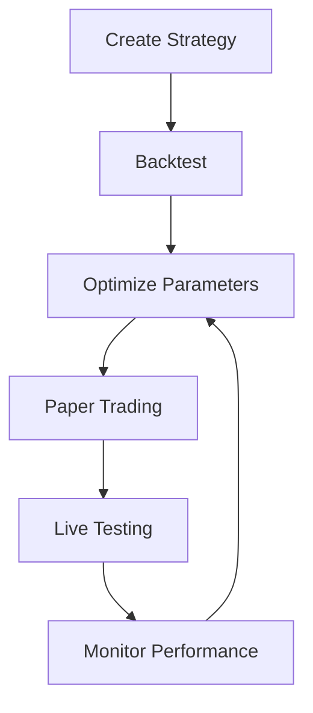
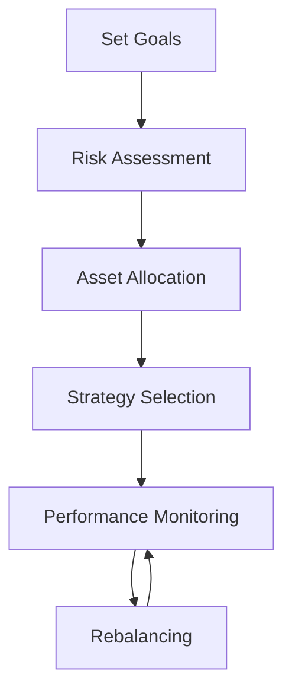

# CryptoTrader UX Matrix

## User Personas

### 1. Professional Trader (PT)
- **Goals**: Maximize profits, minimize risks
- **Pain Points**: 
  - Needs real-time data
  - Requires complex analysis tools
  - Demands high reliability
- **Technical Level**: High
- **Usage Frequency**: Daily, active trading

### 2. Algorithm Developer (AD)
- **Goals**: Implement and test strategies
- **Pain Points**:
  - Needs robust backtesting
  - Requires good documentation
  - Wants clean API access
- **Technical Level**: Very High
- **Usage Frequency**: Regular development cycles

### 3. Casual Investor (CI)
- **Goals**: Portfolio growth, passive income
- **Pain Points**:
  - Needs simple interface
  - Wants clear performance metrics
  - Requires basic automation
- **Technical Level**: Low to Medium
- **Usage Frequency**: Weekly monitoring

## Feature Priority Matrix

| Feature | Impact | Complexity | Priority | Users |
|---------|---------|------------|----------|--------|
| Real-time Data | High | Medium | P0 | PT, AD |
| Backtesting | High | High | P0 | AD, PT |
| Portfolio Dashboard | High | Medium | P0 | All |
| Strategy Development | High | High | P1 | AD |
| Risk Management | High | Medium | P1 | PT, CI |
| User Authentication | Medium | Low | P1 | All |
| Performance Analytics | High | Medium | P1 | All |
| API Documentation | Medium | Low | P2 | AD |
| UI Themes | Low | Low | P3 | All |

## User Workflows

### 1. Trading Workflow

### 2. Strategy Development Workflow

### 3. Portfolio Management Workflow

## Critical User Journeys

### 1. First-Time Setup
1. User Registration ⚡
2. API Key Configuration ⚡
3. Risk Preferences Setup ⚡
4. Strategy Selection
5. Initial Portfolio Setup

### 2. Daily Trading
1. Market Overview ⚡
2. Signal Analysis ⚡
3. Position Management ⚡
4. Performance Review
5. Strategy Adjustment

### 3. Strategy Development
1. Strategy Creation ⚡
2. Backtesting Setup ⚡
3. Parameter Optimization
4. Performance Analysis
5. Deployment

(⚡ = Critical Path)

## UI Component Priority

### High Priority Components
1. **Real-time Market View**
   - Live price charts
   - Order book visualization
   - Trading volume indicators
   - Signal indicators

2. **Portfolio Dashboard**
   - Current positions
   - P&L metrics
   - Risk indicators
   - Performance graphs

3. **Trading Interface**
   - Order entry form
   - Position management
   - Quick trade buttons
   - Risk management controls

### Medium Priority Components
1. **Analytics Panel**
   - Historical performance
   - Strategy metrics
   - Risk analysis
   - Market analysis

2. **Strategy Builder**
   - Parameter configuration
   - Backtesting interface
   - Optimization tools
   - Performance metrics

### Low Priority Components
1. **Settings Panel**
   - User preferences
   - API configuration
   - UI customization
   - Notification settings

## Implementation Phases

### Phase 1: Core Trading (2 Weeks)
- Real-time data integration
- Basic trading interface
- Essential portfolio views
- Critical path features

### Phase 2: Strategy Development (2 Weeks)
- Backtesting engine
- Strategy builder
- Performance analytics
- Documentation

### Phase 3: Advanced Features (2 Weeks)
- Portfolio optimization
- Risk management tools
- Advanced analytics
- API access

### Phase 4: Enhancement (2 Weeks)
- UI/UX improvements
- Performance optimization
- Additional indicators
- Mobile responsiveness

## Success Metrics

### User Engagement
- Daily Active Users (DAU)
- Average Session Duration
- Feature Usage Rates
- Error Rates

### Trading Performance
- Strategy Success Rate
- Portfolio Returns
- Risk-Adjusted Returns
- Trading Volume

### Technical Performance
- Data Latency
- System Uptime
- API Response Time
- Error Recovery Rate

## Immediate Action Items

### Week 1
1. ⚡ Implement real-time data feeds
2. ⚡ Create basic portfolio dashboard
3. ⚡ Set up user authentication

### Week 2
1. ⚡ Develop basic trading interface
2. ⚡ Implement risk management
3. ⚡ Add performance monitoring

### Week 3
1. Build backtesting engine
2. Create strategy builder
3. Add analytics dashboard

### Week 4
1. Implement portfolio optimization
2. Add advanced indicators
3. Complete documentation

## Risk Assessment

### Technical Risks
1. **Data Reliability**
   - Impact: High
   - Mitigation: Multiple data sources, validation

2. **System Performance**
   - Impact: High
   - Mitigation: Optimization, caching, scaling

3. **Security**
   - Impact: Very High
   - Mitigation: Regular audits, best practices

### User Risks
1. **Learning Curve**
   - Impact: Medium
   - Mitigation: Documentation, tutorials

2. **Feature Overwhelm**
   - Impact: Medium
   - Mitigation: Progressive disclosure

## Feedback Loops

### User Feedback
- In-app feedback form
- Usage analytics
- Support tickets
- User interviews

### Performance Feedback
- System metrics
- Trading metrics
- Error logs
- Performance logs

## Success Criteria

### Phase 1
- Real-time data working
- Basic trading functional
- User authentication complete

### Phase 2
- Backtesting operational
- Strategy builder working
- Documentation complete

### Phase 3
- Portfolio optimization working
- Risk management implemented
- API access functional

### Phase 4
- UI/UX polished
- Performance optimized
- Mobile responsive
